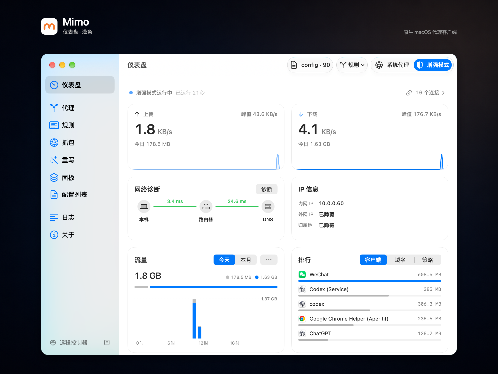
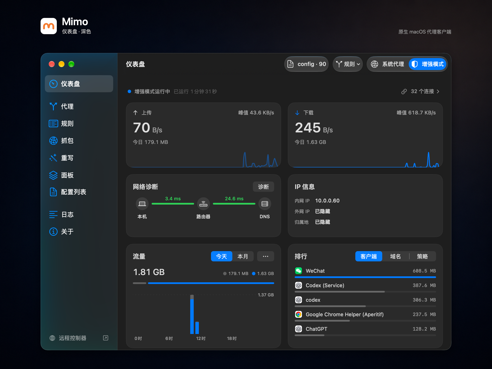
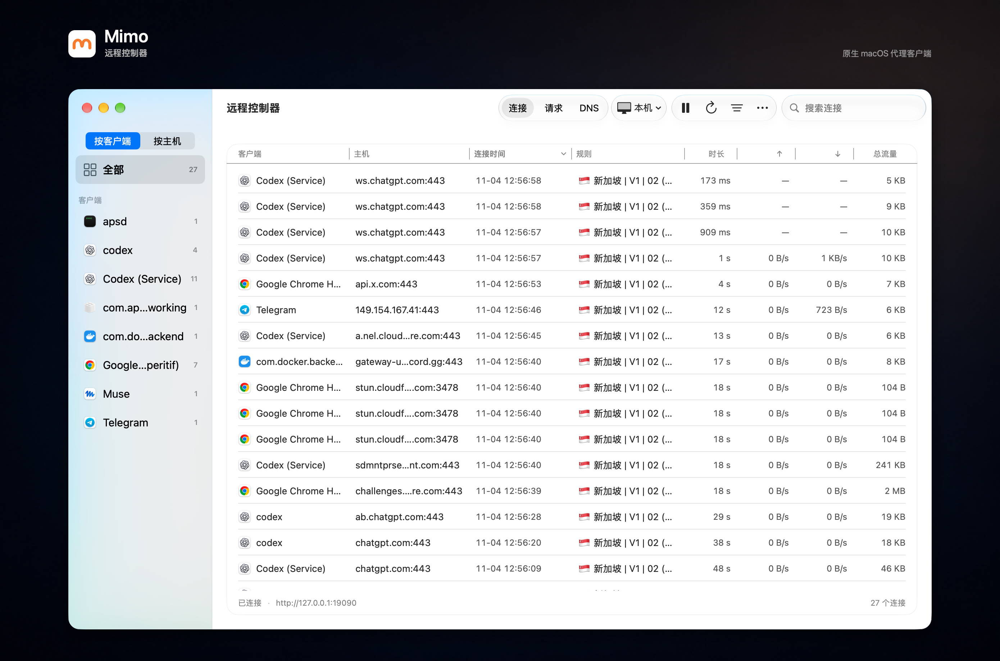
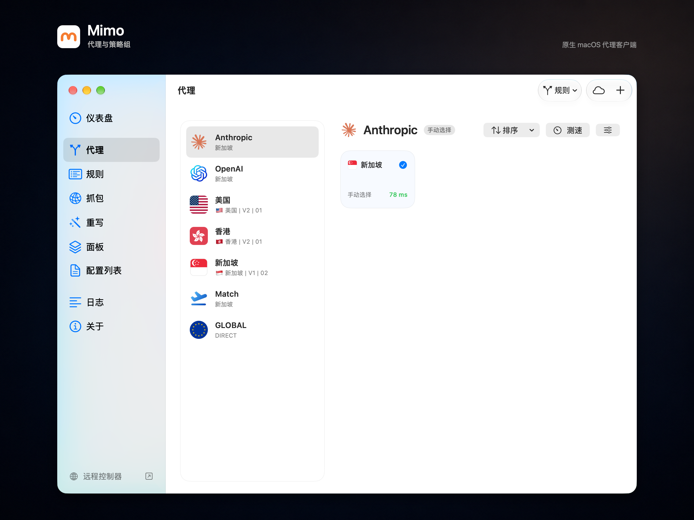
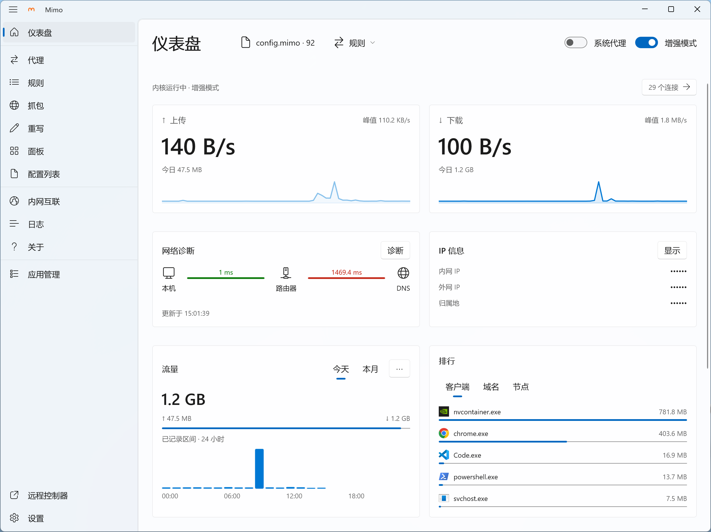
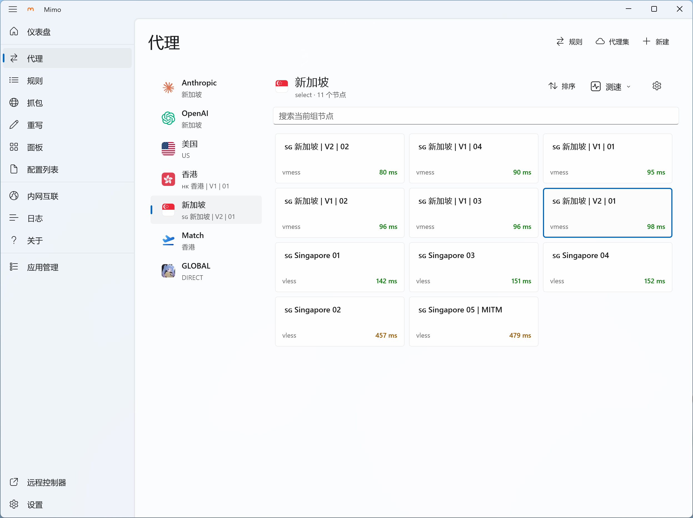
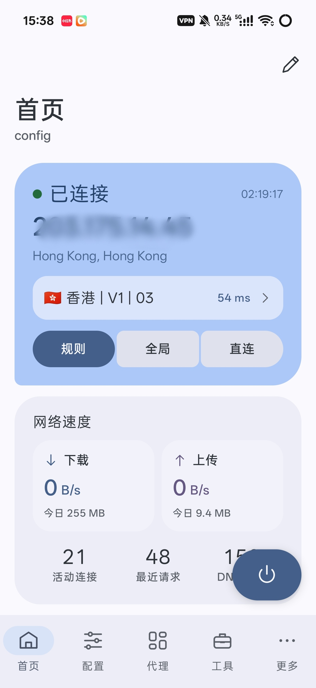
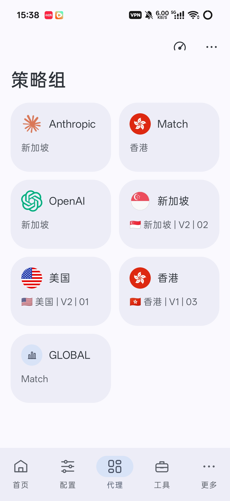
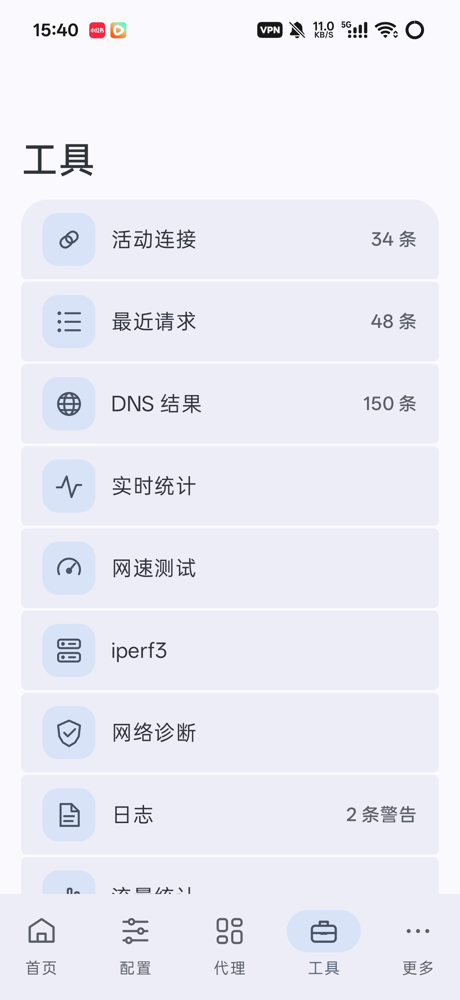

<h1>Mimo</h1>

<strong>English</strong> · <a href="README.zh-CN.md">简体中文</a>

Native proxy clients for macOS, Windows and Android, powered by <a href="https://github.com/MetaCubeX/mihomo">mihomo</a>

  <a href="#download-and-installation"><strong>Download</strong></a> ·
  <a href="https://github.com/MimoProxy/Mimo/releases">Release Notes</a> ·
  <a href="https://github.com/MimoProxy/Mimo/issues">Report an Issue</a>

  Mimo takes its name from the Russian word “Мимо,” meaning “passing by.” 
  May every connection glide past obstacles and carry you freely to wherever you wish to go.

Mimo brings configuration management, node switching, routing rules and network diagnostics to your desktop and phone. Each client follows its platform's interface conventions and bundles the mihomo core.

Mimo requires your own proxy nodes or subscription. It does not provide a proxy service.

## Three Clients

| Client | Requirements | Highlights |
| --- | --- | --- |
| **macOS** | macOS 14+, Apple silicon | Native Mac interface, menu bar controls, MITM capture and rewrites, JavaScript tiles, private networks |
| **Windows** | Windows 11, x64 | WinUI 3 / Fluent interface, system tray controls, process routing, independent remote controller |
| **Android** | Android 8.0+, arm64 | Material 3 Expressive design, customizable home cards, per-app proxying, Zeno / Tailscale access |

All three clients support Clash / mihomo configurations, subscriptions with local overrides, node selection and latency tests, proxy groups, rules, DNS settings, traffic statistics, and backup and restore. Platform-specific features are described below.

### macOS

- **Built for the Mac**: Native navigation and toolbars, light/dark appearance and the system accent color. Control the connection, configurations and nodes from the menu bar or global shortcuts.
- **Proxying and inspection**: System Proxy and Enhanced Mode (TUN), plus a separate Remote Controller for connections, proxy chains and DNS on local or remote mihomo instances.
- **Capture and rewrites**: Inspect HTTP/HTTPS and WebSocket traffic, preview saved media, export HAR, and use supported Loon plugins and Surge HTTP modules.
- **Scriptable tiles**: Edit JavaScript tiles or use templates for memory, traffic, latency, service reachability and exit IP information.
- **Private networks**: Share the Mac's IPv4 LAN through Zeno, or access an existing Tailscale / Headscale network.

### Windows

- **Built for Windows**: WinUI 3 and Fluent controls, a two-column dashboard, system tray controls, login startup, global shortcuts, and Chinese/English interfaces.
- **Desktop proxy control**: System Proxy and Enhanced Mode (TUN), categorized configuration forms and YAML editing, subscription overrides, rule management and process-based routing.
- **Independent Remote Controller**: Inspect local or remote mihomo connections, requests and DNS in a separate window, with process icons, filtering, sorting, connection cleanup and CSV export.
- **Installation and updates**: An EXE installer with bundled runtimes, in-app update checks, download verification, and installation after user confirmation. No separate .NET installation is required.

Windows currently focuses on proxy management and remote control. MITM capture, rewrite execution, JavaScript tile execution and Zeno / Tailscale are not yet available; the corresponding pages indicate their status.

### Android

- **Material 3 Expressive design**: Expressive shapes, prominent connection controls, grouped cards and adaptive app bars, with light and dark themes.
- **Per-app proxying**: Route traffic through mihomo, proxy all apps or only selected apps, or exclude selected apps from the VPN.
- **Configurable home screen**: Arrange cards for connection status, traffic, rankings, DNS, network diagnostics and resource usage. Connect from Quick Settings or a home-screen widget.
- **Edit on the phone**: Import subscriptions, files and node links; use categorized forms or the YAML editor with highlighting and search/replace. Saved node choices can be restored before the VPN takes over traffic.
- **Mobile diagnostics**: Inspect recent requests, active connections, matched rules, DNS records and logs; use network and bandwidth tools, or share an authenticated proxy on the local network.
- **Private networks on the go**: Access home devices through a Zeno-enabled Mac, or use Tailscale / Headscale. Both services share Mimo's VPN and can be enabled independently.

## Screenshots

### macOS

#### Dashboard · Light

#### Dashboard · Dark

#### Remote Controller

#### Proxies and Groups

### Windows

#### Dashboard

#### Proxies and Groups

### Android

<table>
  <tr>
    <th>Home</th>
    <th>Policy Groups</th>
    <th>Tools</th>
  </tr>
  <tr>
    <td></td>
    <td></td>
    <td></td>
  </tr>
</table>

## Download and Installation

| Platform | Download | Package |
| --- | --- | --- |
| macOS | [macOS release](https://github.com/MimoProxy/Mimo/releases/latest) | `Mimo-….zip` · Apple silicon |
| Windows | [Windows release](https://github.com/MimoProxy/Mimo/releases/tag/windows-v1.0.0.1) | `Mimo-Windows-x64-Setup.exe` · x64 |
| Android | [Android release](https://github.com/MimoProxy/Mimo/releases/tag/android-v1.0.5) | `Mimo-Android-….apk` · arm64 |

All official packages are published in [Releases](https://github.com/MimoProxy/Mimo/releases). GitHub's **Latest** label points to the macOS release; Windows and Android use their own release tags and update feeds.

### macOS

Unzip the package, drag `Mimo.app` into Applications, and open it. Requires **macOS 14 or later** on an **Apple silicon Mac (M1 or later)**.

If macOS cannot verify the developer on first launch, confirm that you downloaded the app from the release page above. Then follow [Apple's instructions](https://support.apple.com/en-us/102445) to choose **Open Anyway** in **System Settings → Privacy & Security**.

### Windows

Run `Mimo-Windows-x64-Setup.exe`. It installs for the current user, adds an uninstall entry, and includes the required runtimes. Requires **Windows 11 x64**. Ordinary system proxy use does not need administrator access; Enhanced Mode requests authorization to install its service.

### Android

Install the APK on **Android 8.0 or later** with an **arm64** processor. If prompted, allow installation from the browser or file manager you used. Import a configuration and tap Connect, then approve Android's VPN permission.

## macOS Configuration Guide

| Approach | Best for |
| --- | --- |
| Provider configuration | Using the nodes, DNS, proxy groups, and rules supplied by a subscription. Local changes are preserved when the subscription updates. |
| Custom configuration + remote proxy sets | Managing your own DNS, proxy groups, and rules while fetching only nodes from subscriptions. Multiple proxy sets can be added. |

Remote proxy sets are available from the toolbars on the Proxies and Configurations pages. They contribute nodes to custom configurations without importing the provider's DNS or rules.

To add individual nodes, use the Proxies category in the configuration editor. You can paste node share links or Base64 text, or enter the settings manually. Subscription URLs and node share links use separate import options.

## Private Networks: macOS and Android

On macOS, open **Private Network** in the sidebar; on Android, open **Tools → Private Network**. Zeno and Tailscale have independent controls:

- **Zeno**: Use the Mac as a sharing endpoint for its local IPv4 networks. Pair it with Mimo on Android to access NAS devices, routers and other local services by their private IP addresses.
- **Tailscale / Headscale**: Access devices and configured subnets in an existing Tailnet. Set the hostname, authentication key, HTTPS control-server address and destination subnets.

To use Zeno:

1. Enable Zeno on the Mac, save, and turn on System Proxy or Enhanced Mode. Keep the Mac online and awake.
2. Copy the **Peer ID** and **Local Subnets** into **Tools → Private Network** in Mimo for Android, enable Zeno, and save.
3. Connect from the Android home screen, then access the devices by their local IP addresses.

Zeno and Tailscale can be enabled together. They run while Mimo's proxy connection is active; stopping the connection or quitting Mimo stops the services.

## Capture (MITM) and Rewrites: macOS

Use **Capture** to inspect HTTP/1.1, HTTP/2 and WebSocket traffic, including request and response headers, bodies, status codes and timing. Search and filter records, copy requests as curl, export HAR files, and preview saved images, audio and video. Each request or response body has a configurable **1–64 MiB** saving limit; the default is **1 MiB**.

Use **Rewrites** for URL, header and body rewrites, local responses and JavaScript request/response scripts. Import Loon plugins or Surge HTTP modules (`.sgmodule`), preview their contents, and enable the modules you need. This covers supported HTTP module features rather than full Loon or Surge configurations.

For HTTPS decryption, first generate, install and trust this Mac's certificate in **Settings → MITM**, then start capture. MITM runs in **Rule mode** with System Proxy or Enhanced Mode. HTTP/3 is not decrypted, and apps with certificate pinning may need to be excluded. Ordinary proxying and routing do not require installing the certificate.

## Updates and Backups

- **App updates**: macOS offers **Check for Updates** in About; Windows uses **About → App Updates**; Android uses **More → About & Privacy**. Downloads and installation remain under your control. The core is updated with the app.
- **Subscription updates**: All three clients support manual and scheduled updates while retaining local overrides.
- **Backups**: macOS and Windows provide backup and restore in their data settings; Android provides it under More. Backups are for recovery, and their contents differ by client.
- **Configuration sharing**: Use `.mimo.yaml` exports to share custom configurations and subscription links. Review platform-managed settings after importing; a configuration export is not a full cross-platform settings backup.

Configurations and subscription credentials are stored locally without encryption. Backups and exports that retain subscriptions may also contain node passwords and subscription URLs. Keep these files secure.

## FAQ

### Are traffic capture and rewrites available on every client?

They are available in the [macOS client](#capture-mitm-and-rewrites-macos). Windows and Android do not currently provide the same MITM capture and rewrite execution features. HTTPS inspection on macOS requires trusting Mimo's certificate; ordinary proxying and rule-based routing do not.

### How do I quit or uninstall the macOS client?

Quit Mimo from the app menu or menu bar panel to stop the core and restore system proxy settings. Closing the main window keeps Mimo available in the menu bar.

If you installed Mimo's MITM certificate, remove it in **Settings → MITM** before uninstalling. If you installed the Enhanced Service, remove it from About first. Then quit Mimo and move `Mimo.app` to the Trash. Deleting the app does not automatically remove local configurations; export a backup first if you want to keep your data.

## Feedback

When opening a [GitHub issue](https://github.com/MimoProxy/Mimo/issues), include the client platform, Mimo version, operating-system version, proxy mode, steps to reproduce, and any error messages. Attach a diagnostic export if available.

Before posting publicly, redact subscription URLs, node passwords, tokens, and other sensitive information.

## Acknowledgments

Thanks to [MetaCubeX / mihomo](https://github.com/MetaCubeX/mihomo), [Sparkle](https://github.com/sparkle-project/Sparkle), [Yams](https://github.com/jpsim/Yams), and their contributors. Third-party licenses are included with the app.

Mimo's MITM backend is based on [gtoxlili/mihomo-capture](https://github.com/gtoxlili/mihomo-capture), with adaptations for Mimo's managed runtime and native interface. Thanks to gtoxlili and the project's contributors. The upstream [MIT license](https://github.com/gtoxlili/mihomo-capture/blob/1bddd4282dfdc43f2c0a320e1500204bfcc7779c/LICENSE), original copyright notice, dependency notices and modified backend source are included in the app under `Contents/Resources/ThirdParty/MimoCapture`.

Special thanks to [Stash](https://stash.ws/). Its outstanding design has been a source of inspiration for Mimo's design and development.
