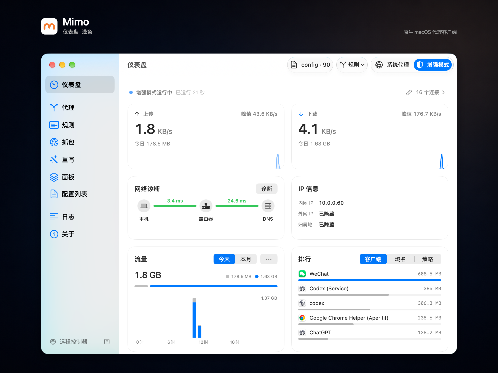
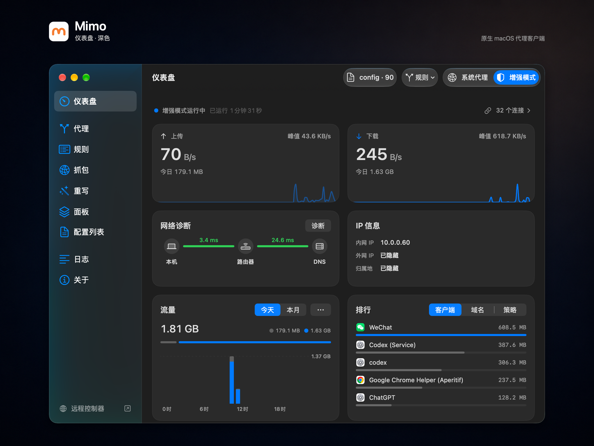
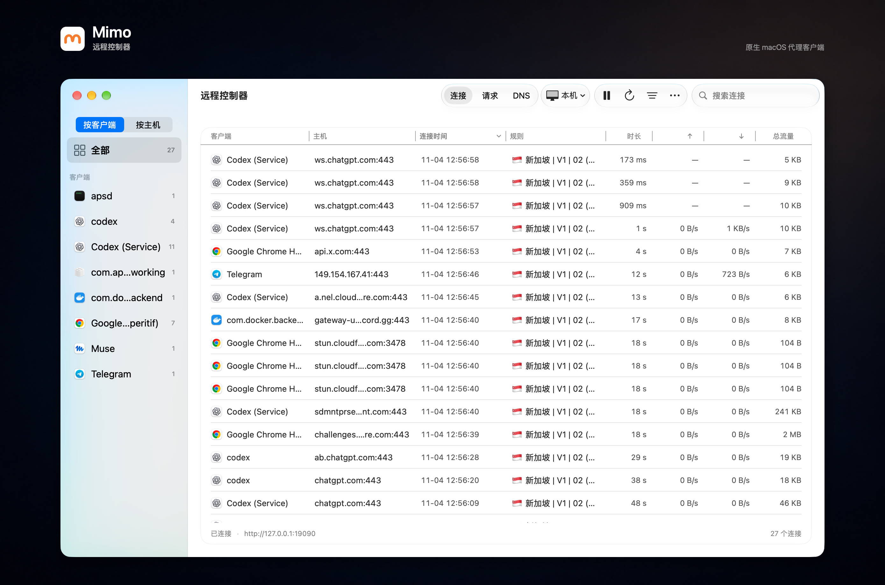
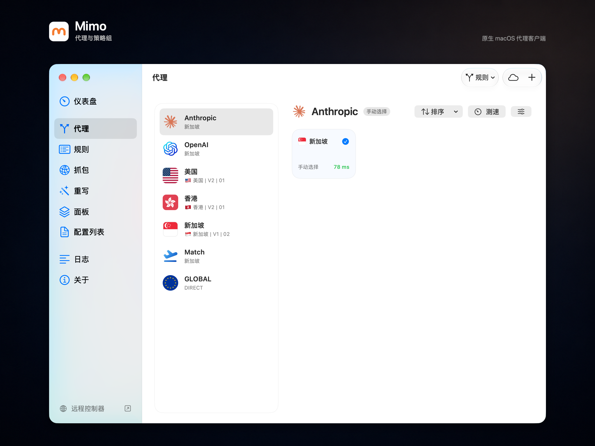

<h1>Mimo</h1>

<a href="README.md">English</a> · <strong>简体中文</strong>

基于 <a href="https://github.com/MetaCubeX/mihomo">mihomo</a>，面向 macOS、Windows 和 Android 的原生代理客户端

  <a href="#下载与安装"><strong>下载客户端</strong></a> ·
  <a href="https://github.com/MimoProxy/Mimo/releases">更新记录</a> ·
  <a href="https://github.com/MimoProxy/Mimo/issues">问题反馈</a>

  Mimo 的名字源自俄语「Мимо」，有「从旁经过」之意。 
  愿每一次连接，都能轻巧地绕过阻碍，自在抵达你想去的地方。

在电脑和手机上管理配置、切换节点、设置分流并诊断网络。三个客户端遵循各自平台的操作习惯，均内置 mihomo 内核。

Mimo 需要你自行提供代理节点或订阅，不提供代理服务。

## 三个客户端

| 客户端 | 系统要求 | 主要特点 |
| --- | --- | --- |
| **macOS** | macOS 14+、Apple silicon | 原生 Mac 界面、菜单栏控制、MITM 抓包与重写、JavaScript 磁贴、内网互联 |
| **Windows** | Windows 11、x64 | WinUI 3／Fluent 界面、系统托盘、按进程分流、独立远程控制器 |
| **Android** | Android 8.0+、arm64 | 免 root 系统 VPN、分应用代理、自定义首页卡片、Zeno／Tailscale 内网访问 |

三端均支持 Clash／mihomo 配置、订阅与本地覆写、节点选择与延迟测试、策略组、规则、DNS 设置、流量统计，以及备份与恢复。各客户端的特色功能如下。

### macOS

- **贴合 Mac 的操作**：原生导航与工具栏，支持浅色／深色外观和系统强调色；通过菜单栏或全局快捷键控制连接、配置与节点。
- **代理与远控**：支持系统代理和增强模式（TUN）；独立远程控制器可查看本机或远程 mihomo 的连接、代理链与 DNS。
- **抓包与重写**：检查 HTTP／HTTPS、WebSocket 流量，预览已保存媒体、导出 HAR，并使用已支持的 Loon 插件与 Surge HTTP 模块。
- **脚本磁贴**：编辑 JavaScript 磁贴，或使用内存、流量、延迟、服务可达性和出口 IP 信息模板。
- **内网互联**：通过 Zeno 共享 Mac 所在的 IPv4 局域网，或访问已有 Tailscale／Headscale 网络。

### Windows

- **贴合 Windows 的操作**：WinUI 3 与 Fluent 控件，双列仪表盘、系统托盘、登录启动、全局快捷键和中英文界面。
- **桌面代理管理**：支持系统代理与增强模式（TUN）、分类表单和 YAML 编辑、订阅覆写、规则管理及按进程分流。
- **独立远程控制器**：单独窗口查看本机或远程 mihomo 的连接、请求与 DNS，支持进程图标、筛选排序、断开连接及 CSV 导出。
- **安装与更新**：提供内置运行库的 EXE 安装包，支持应用内检查更新、下载校验及确认后安装，无需另外安装 .NET。

Windows 当前侧重代理管理与远程控制，暂不提供 MITM 抓包、重写执行、JavaScript 磁贴执行和 Zeno／Tailscale 功能；对应页面会标明状态。

### Android

- **一个 VPN，免 root**：通过系统 VPN 将流量交给 mihomo，支持全部应用、仅代理所选应用，或让指定应用绕过 VPN。
- **自定义首页**：排列连接状态、流量、排行、DNS、网络诊断和运行资源等卡片；支持系统快捷设置磁贴和桌面小组件。
- **在手机上编辑配置**：导入订阅、文件与节点链接，使用分类表单或带语法高亮、搜索替换的 YAML 编辑器；可在 VPN 接管流量前恢复已保存的节点选择。
- **移动网络工具**：查看最近请求、活动连接、匹配规则、DNS 记录与日志，使用网络和带宽工具，或向局域网提供带认证的代理共享。
- **在外访问内网**：通过启用 Zeno 的 Mac 访问家庭设备，也可接入 Tailscale／Headscale；两项服务共用 Mimo 的 VPN，可分别启用。

## 界面预览

以下截图展示 macOS 客户端。

### 仪表盘 · 浅色

### 仪表盘 · 深色

### 远程控制器

### 代理与策略组

## 下载与安装

| 平台 | 下载入口 | 安装包 |
| --- | --- | --- |
| macOS | [macOS 正式版](https://github.com/MimoProxy/Mimo/releases/latest) | `Mimo-….zip` · Apple silicon |
| Windows | [Windows 正式版](https://github.com/MimoProxy/Mimo/releases/tag/windows-v1.0.0.1) | `Mimo-Windows-x64-Setup.exe` · x64 |
| Android | [Android 正式版](https://github.com/MimoProxy/Mimo/releases/tag/android-v1.0.5) | `Mimo-Android-….apk` · arm64 |

正式安装包统一发布在 [Releases](https://github.com/MimoProxy/Mimo/releases)。GitHub 的 **Latest** 标记指向 macOS 版，Windows 和 Android 使用各自的发布标签与更新清单。

### macOS

解压安装包，将 `Mimo.app` 拖入“应用程序”文件夹并打开。需要 **macOS 14 或更新版本**及 **Apple silicon Mac（M1 及更新芯片）**。

首次打开如果 macOS 提示无法验证开发者，请确认文件来自上面的发布页，再按 [Apple 的说明](https://support.apple.com/zh-cn/102445)，在“系统设置 → 隐私与安全性”中选择“仍要打开”。

### Windows

运行 `Mimo-Windows-x64-Setup.exe`，按提示安装到当前用户目录。安装包包含所需运行库，并提供卸载入口。需要 **Windows 11 x64**。普通系统代理无需管理员权限；增强模式会请求授权安装服务。

### Android

在 **Android 8.0 或更新版本**的 **arm64** 设备上安装 APK。若系统提示，允许用于下载的浏览器或文件管理器安装应用。导入配置并点击连接，首次使用时允许系统 VPN 权限，无需 root。

## macOS 配置怎么选

| 方式 | 适合谁 |
| --- | --- |
| 服务商配置 | 希望直接使用订阅提供的节点、DNS、策略组与规则；本地修改会在订阅更新后保留 |
| 自定义配置 + 远程代理集 | 希望自行维护 DNS、策略组与规则，只从订阅获取节点；可添加多个代理集 |

“远程代理集”入口位于“代理”和“配置列表”的工具栏。它只向自定义配置提供节点，不会带入服务商的 DNS 或规则。

单独的节点可在配置编辑器的“代理”分类中添加，支持粘贴节点分享链接、Base64 文本或手动填写。订阅 URL 导入与节点链接导入是不同入口。

## 内网互联：macOS 与 Android

macOS 在侧边栏打开「内网互联」，Android 打开「工具 → 内网互联」。Zeno 与 Tailscale 分别配置、独立开关：

- **Zeno**：Mac 作为共享端，提供本机可访问的 IPv4 内网。配合 Android 端 Mimo，通过内网 IP 访问 NAS、路由器等设备。
- **Tailscale／Headscale**：访问已有 Tailnet 中的设备和已配置的网段，可设置设备名、认证密钥、HTTPS 控制服务器地址和访问网段。

使用 Zeno：

1. 在 Mac 上启用 Zeno 并保存，再开启系统代理或增强模式；保持 Mac 联网、不休眠。
2. 复制「Peer ID」和「本机网段」，填入 Android 端 Mimo 的「工具 → 内网互联」，启用 Zeno 并保存。
3. 在 Android 首页连接，随后通过内网 IP 访问设备。

Zeno 与 Tailscale 可以同时启用，随 Mimo 的代理连接运行；关闭连接或退出 Mimo 时停止。

## MITM 抓包与重写：macOS

在「抓包」中查看 HTTP/1.1、HTTP/2 和 WebSocket 流量，包括请求／响应头、正文、状态码和耗时。支持搜索筛选、复制 curl、导出 HAR，以及已保存图片、音频和视频的预览。每个请求或响应正文的保存上限可设为 **1–64 MiB**，默认 **1 MiB**。

在「重写」中配置 URL、请求头／响应头和正文改写、本地响应，以及 JavaScript 请求／响应脚本。支持导入 Loon 插件和 Surge HTTP 模块（`.sgmodule`），预览内容后按需启用；兼容范围为已支持的 HTTP 模块功能。

解密 HTTPS 前，先在「设置 → MITM」生成、安装并信任本机证书，再开始抓包。MITM 在系统代理或增强模式的**规则模式**下运行，不解密 HTTP/3；使用证书固定的应用可能需要加入排除列表。普通代理与分流不需要安装此证书。

## 更新与备份

- **应用更新**：macOS 在“关于”中检查更新，Windows 位于“关于 → 应用更新”，Android 位于“更多 → 关于与隐私”。下载与安装由你控制，内核随应用一同更新。
- **订阅更新**：三端均支持手动与定时更新，并保留本地覆写。
- **备份与恢复**：macOS 和 Windows 在数据设置中操作，Android 在“更多”中操作。备份用于恢复数据，各端包含的内容有所不同。
- **配置分享**：使用 `.mimo.yaml` 导出分享自定义配置与订阅链接，导入后检查由各平台管理的设置；配置导出不等于整套应用设置的跨端备份。

配置与订阅凭据保存在本机，尚未加密存储。备份和保留订阅的导出文件也可能包含节点密码、订阅地址，请妥善保管。

## 常见问题

### 三个客户端都支持抓包与重写吗？

目前由 [macOS 客户端](#mitm-抓包与重写macos)提供，Windows 和 Android 尚不提供同等的 MITM 抓包与重写执行功能。macOS 解密 HTTPS 需要信任 Mimo 的本机证书；普通代理和分流不需要安装证书。

### 如何退出或卸载 macOS 客户端？

从应用菜单或菜单栏面板退出 Mimo，会停止内核并恢复系统代理。关闭主窗口后仍可通过菜单栏使用。

若安装过 Mimo 的 MITM 证书，请先在「设置 → MITM」中移除。若安装过增强服务，先在“关于”中点击“移除增强服务”，再退出并将 `Mimo.app` 移到废纸篓。删除应用不会自动清除本地配置；需要保留数据时可先导出备份。

## 反馈

请在 [GitHub Issues](https://github.com/MimoProxy/Mimo/issues) 中提供客户端平台、Mimo 版本、操作系统版本、使用模式、复现步骤和错误提示；如有诊断导出，可一并附上。

公开反馈前，请隐去订阅链接、节点密码、令牌等敏感信息。

## 致谢

感谢 [MetaCubeX / mihomo](https://github.com/MetaCubeX/mihomo)、[Sparkle](https://github.com/sparkle-project/Sparkle) 和 [Yams](https://github.com/jpsim/Yams) 及其贡献者。第三方组件的许可证随应用附带。

Mimo 的 MITM 后端基于 [gtoxlili/mihomo-capture](https://github.com/gtoxlili/mihomo-capture) 适配，加入了 Mimo 的受管运行方式和原生界面。感谢 gtoxlili 及项目贡献者。应用的 `Contents/Resources/ThirdParty/MimoCapture` 中保留了上游 [MIT 许可证](https://github.com/gtoxlili/mihomo-capture/blob/1bddd4282dfdc43f2c0a320e1500204bfcc7779c/LICENSE)、原作者版权声明、依赖声明及修改后的后端源码。

特别感谢 [Stash](https://stash.ws/)。这款设计出色的软件，为 Mimo 的设计与开发带来了许多启发。
